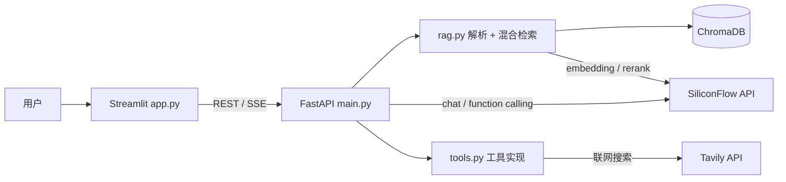

# 知识库智能问答与文档生成 Agent

上传文档 → 混合检索 → 带来源引用的问答 → 一键导出 Word / Excel。

基于 FastAPI + Streamlit 的本地知识库应用：后端提供 REST 与 SSE 接口，
前端实现流式对话；检索侧采用向量 + BM25 双路召回，Agent 侧通过
Function Calling 自主编排检索、联网与文档生成工具。

## 功能特性

- **文档入库**：支持 TXT / Markdown / PDF / DOCX 四类解析，按 500 字切块、
  50 字重叠，避免语义断链
- **混合检索**：向量召回与 BM25 关键词召回各取 Top-10，经 RRF 融合后由
  bge-reranker 精排，兼顾语义泛化与专有名词精确匹配
- **可信问答**：强约束提示词约束「无依据则拒答」，答案附来源文件名与片段
  预览，可核对
- **Agent 工具编排**：Function Calling 多步循环（最多 5 轮），编排本地检索、
  Tavily 联网搜索、Word 与 Excel 生成四类工具
- **办公文件生成**：Word 由 python-docx 直出；Excel 以 CSV 作为模型与代码的
  结构化契约，pandas 解析 + openpyxl 输出带表头样式与自适应列宽的表格
- **流式体验**：server-sent events 推送三类事件（`status` / `text` / `files`），
  前端分别渲染工具执行状态、打字机正文与产物下载链接

## 架构



### 检索链路

```
query
  ├─ 向量召回 Top-10  ─┐
  └─ BM25 召回 Top-10 ─┴─ RRF(k=60) 融合 ─→ bge-reranker 精排 ─→ Top-K
```

重排接口异常时自动降级为融合结果直接截断，保证检索链路不中断。

### Agent 循环

采用「先非流式判定工具、再流式输出正文」的两段式设计：第一轮非流式调用
只用于决定是否调用工具，工具执行结果回填 `role=tool` 后继续推理；确认不再
调用工具时，再开启流式请求输出最终答案，兼顾决策准确性与首字延迟。

## 快速开始

```bash
# 1. 环境
python -m venv venv
venv\Scripts\activate        # Windows
pip install -r requirements.txt

# 2. 配置密钥
set SILICONFLOW_API_KEY=sk-xxxx        # embedding / chat / rerank 默认硅基流动
set TAVILY_API_KEY=tvly-xxxx           # 联网搜索 TAVILY

# 3. 启动后端（默认 8000）
uvicorn main:app --reload --port 8000

# 4. 启动前端
streamlit run app.py
```

## 配置

| 环境变量 | 用途 | 必需 |
| --- | --- | --- |
| `SILICONFLOW_API_KEY` | embedding、chat completion、rerank | 是 |
| `TAVILY_API_KEY` | 联网搜索工具 | 否（不配则联网搜索不可用） |

## 接口

| 方法 | 路径 | 说明 |
| --- | --- | --- |
| GET | `/health` | 健康检查 |
| POST | `/upload` | 上传文档并建立索引 |
| POST | `/search` | 纯检索，返回片段与来源 |
| POST | `/ask` | 检索 + 生成回答，附来源 |
| POST | `/agent` | Agent 对话，SSE 流式返回 |
| GET | `/download/{filename}` | 下载生成的 Word / Excel |

`/agent` 的 SSE 事件格式：

```json
{"type": "status", "content": "正在执行: local_knowledge_search ..."}
{"type": "text",   "content": "根据文档……"}
{"type": "files",  "content": ["报告_20261026_101500.docx"]}
```

## 目录结构

```
knowledge-qa/
├── main.py           FastAPI 入口：上传、检索、问答、Agent、下载
├── app.py            Streamlit 前端：知识库管理 + 流式对话
├── rag.py            文档解析、切块、向量化、混合检索与重排
├── tools.py          Agent 工具实现（联网 / Word / Excel / 本地检索）
├── tools_json.py     工具的 Function Calling schema
├── config.py         Chroma 客户端、集合、请求模型、LLM 客户端
├── uploads/          上传的原始文件与抽取文本（不入库）
├── outputs/          生成的 Word / Excel（不入库）
└── chroma_db/        向量库持久化目录（不入库）
```

## 工程细节

- **索引幂等**：以内容指纹（SHA-1）而非文件名生成 chunk id，写入前按来源与
  内容双维度清理旧分块，重复上传不产生残留、同一文档换格式上传不重复入库
- **大模型容错**：针对部分模型把工具调用模板当作正文输出的问题，实现
  「异常识别 → 丢弃异常文本并提示改用标准 tool_calls 重试 → 连续失败降级」
  闭环，避免工具调用静默失效
- **下载链路**：URL 解码后再做 basename 剥离，防止路径穿越
- **文件名清洗**：统一过滤非法字符并追加时间戳，避免覆盖

## 已知限制

- 单机单进程设计，Chroma 为本地持久化，未做并发压测与访问鉴权
- 对话历史直接截断最近 10 轮，未做摘要压缩
- 分块策略固定 500/50，尚未按文档类型自适应
- 前端为原型实现，未接入登录与权限体系

## License

MIT